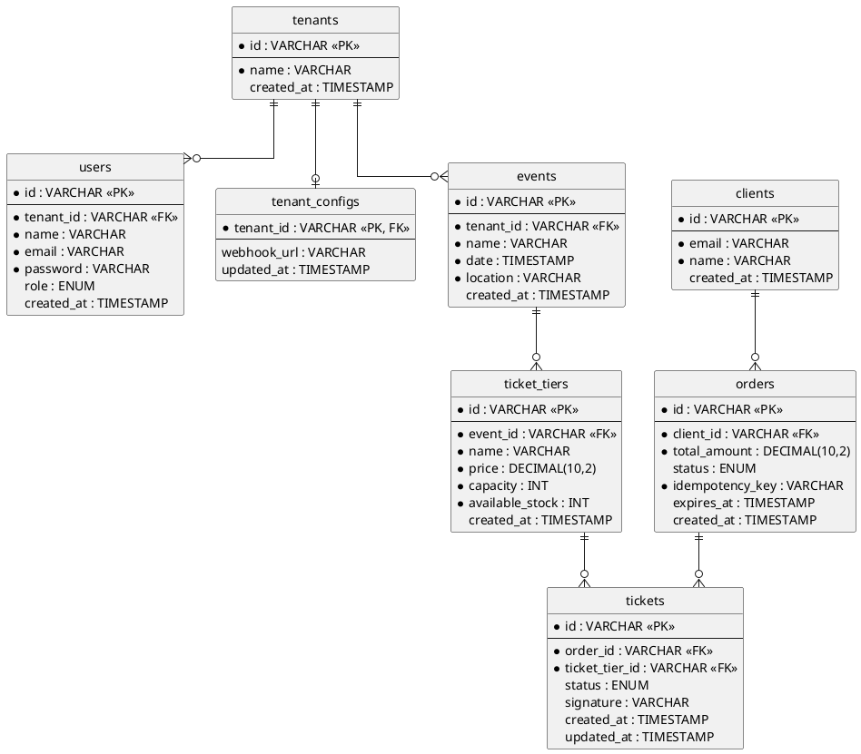

# 🎟️ TicketRush - B2B Ticketing & Reservation Engine

TicketRush es una plataforma SaaS B2B de gestión de eventos y venta de entradas. Más allá de un simple CRUD, el proyecto fue diseñado como un motor transaccional de alto rendimiento para resolver los problemas reales de la industria del ticketing: concurrencia masiva, sobreventa de inventario, reservas temporales y validación criptográfica en puerta.

## 🎯 Propósito del Proyecto

El propósito principal de TicketRush es proporcionar a pequeños y medianos organizadores de eventos (teatros, clubes, productores independientes) una herramienta robusta para vender y validar accesos, mientras sirve como demostración técnica de patrones de arquitectura avanzada.

El sistema garantiza que:

- **Nunca se sobrevenda una entrada**, incluso bajo alta demanda simultánea.
- **El inventario no quede bloqueado indefinidamente** por usuarios que abandonan el proceso de compra.
- **Se prevenga el fraude** mediante la validación matemática de los pases en la puerta.
- **Sea altamente integrable**, permitiendo a los negocios conectar la plataforma con sus propios flujos de trabajo (CRMs, Slack, n8n) mediante eventos asíncronos.

## ✨ Características Principales (Arquitectura Core)

- **Aislamiento Multi-Tenant**: Arquitectura orientada a B2B. Los datos, empleados y configuraciones están aislados por organización (Tenant).
- **Pessimistic Locking (Anti-Sobreventa)**: Implementación de bloqueos a nivel de base de datos (`SELECT ... FOR UPDATE`) sobre el inventario disponible (`available_stock`) para garantizar transacciones ACID durante picos de tráfico.
- **Soft Reserve (Motor de Colas)**: Sistema de reservas temporales apoyado en Redis. Al iniciar una compra, el inventario se bloquea. Un Delayed Job evalúa la orden tras 10 minutos; si el pago no se completó, el sistema reintegra automáticamente el stock.
- **Idempotencia de Pagos**: Prevención de cobros y reservas duplicadas en caso de fallos de red o reintentos del cliente mediante el uso de llaves de idempotencia (`Idempotency-Key`).
- **Billetes Criptográficos (Anti-Fraude)**: Los códigos de acceso no almacenan IDs simples. Utilizan firmas de seguridad (Secure Signatures / HMAC) que permiten validar la autenticidad del boleto en la puerta sin riesgo de falsificación.
- **Motor de Webhooks Salientes**: Sistema basado en eventos que emite Webhooks (POST HTTP) hacia servicios externos (como n8n o Zapier) cada vez que se concreta una venta, permitiendo automatizar marketing y notificaciones.

## 🛠️ Tecnologías Utilizadas

El proyecto utiliza un enfoque agnóstico en su base de datos, pero se apoya en el ecosistema de TypeScript para garantizar tipado estricto de extremo a extremo.

**Backend & Infraestructura:**
- **NestJS**: Framework principal (Node.js).
- **Prisma ORM**: Manejo de base de datos y migraciones.
- **PostgreSQL / MySQL**: Base de datos relacional transaccional.
- **Redis & BullMQ**: Orquestación de colas, Delayed Jobs y manejo de eventos asíncronos.
- **Docker & Docker Compose**: Contenerización de infraestructura.

**Frontend:**
- **Vue 3 (Composition API)**: Interfaz de usuario reactiva.
- **Vite**: Herramienta de construcción (Bundler).
- **Tailwind CSS**: Diseño UI utilitario y responsivo.

## 🏗️ Estructura del Proyecto

El proyecto está organizado en un formato de Monorepo, separando claramente las responsabilidades del cliente y el servidor. El backend sigue un patrón de diseño clásico de capas (Controller -> Service -> Repository) consolidado en un único módulo para priorizar la agilidad de entrega sin sacrificar la mantenibilidad.

```text
ticketrush/
├── frontend/                 # Aplicación SPA (Vue 3 + Tailwind)
│
├── backend/                  # API RESTful (NestJS)
│   ├── src/
│   │   ├── main.ts           # Punto de entrada, configuración de CORS y validaciones globales
│   │   ├── app.module.ts     # Módulo centralizado
│   │   │
│   │   ├── controllers/      # Capa de Presentación (Endpoints HTTP)
│   │   ├── dtos/             # Objetos de Transferencia de Datos (Validación de esquemas)
│   │   ├── services/         # Capa de Lógica de Negocio (Reglas comerciales y orquestación)
│   │   ├── repositories/     # Capa de Acceso a Datos (Aislamiento de Prisma y SQL crudo)
│   │   ├── jobs/             # Capa Asíncrona (Processors de BullMQ para colas de Redis)
│   │   └── infrastructure/   # Conexiones externas (PrismaService, configuración de Redis)
│   │
│   └── prisma/
│       └── schema.prisma     # Definición del esquema relacional y abstracción de BD
│
└── docker-compose.yml        # Orquestación local (Servidor SQL + Redis)
```

## 🗄️ Diagrama Entidad-Relación (Base de Datos)



## 🚀 Despliegue Local (Getting Started)

Clonar el repositorio:
```bash
git clone https://github.com/tu-usuario/ticketrush.git
cd ticketrush
```

Levantar la infraestructura base (Base de Datos y Redis):
```bash
docker-compose up -d
```

Configurar y arrancar el Backend:
```bash
cd backend
npm install
# Configurar variables de entorno (.env)
npx prisma migrate dev
npm run start:dev
```

Arrancar el Frontend:
```bash
cd ../frontend
npm install
npm run dev
```

---
*Diseñado como prueba de concepto para arquitecturas de alta concurrencia y despliegues B2B.*
